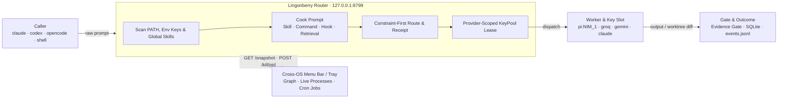

<div align="center">

# Lingonberry Router

**One local, cross-OS router for every AI agent on your machine.**  
Scan once, self-configure globally through your shared skills and constitution, cook raw prompts into verified dispatches, lease provider keys safely, and oversee live workers from a clean menu bar.

[Website](https://lingonberry-router.vercel.app) · [Install](#install) · [Architecture](#architecture) · [Global Self-Config](#global-first-self-configuration) · [CLI](#cli) · [HTTP API](#http-api) · [Known Gaps](#known-gaps)

[](https://github.com/brusnyak/lingonberry-router/actions/workflows/ci.yml)


</div>

---

## Why

| Without Lingonberry Router | With Lingonberry Router |
|---|---|
| Each agent manages its own API keys and prompts | Keys stay in `~/.env` or `~/.config/lingonberry/env`; the router leases slot names only |
| Updating routing rules across 5+ CLIs is repetitive | Global-first self-config writes one shared skill + constitution and light per-agent pointers |
| Long, raw prompts run without matching skills or retrieval | Prompts are cooked with matching skills, commands, hooks, and workspace context first |
| One runaway agent can burn a shared quota | Provider-scoped key pool enforces 3 concurrent runs and 40 calls/min per slot |
| Stuck child processes and cron jobs stay invisible | Cross-OS menu bar shows `Caller → Router → Worker (Key Slot) → Gate/Outcome`, live PIDs, Kill, and Cron Jobs |

---

<a id="architecture"></a>

## Architecture



1. **Discover & Self-Configure.** `lingonberry-core init` scans `PATH` for agent CLIs, env files for key *names*, and shared global skill directories (`~/.agent-skills`, `~/.claude/skills`, `~/.codex/skills`, `~/.config/opencode/skills`) to pick the cleanest global injection path.
2. **Cook & Route.** `route` enriches raw prompts with the matching global skill, command, hook, and retrieved project context, filters workers by write-access and key constraints, and records a cryptographic receipt without running anything.
3. **Lease.** A key is leased strictly within the worker's provider boundary. A NIM request never receives a GROQ or Gemini key. Each key allows 3 concurrent runs and 40 calls per minute; a dispatch waits up to 30 s, then fails.
4. **Execute & Oversee.** CLI agents run non-interactively with stdin closed (`claude -p`, `codex exec`, `opencode run`, `omp -p`); API workers call the provider chat-completions endpoint. Every live PID is tracked in the menu bar and can be terminated cleanly via `POST /kill/{pid}`.
5. **Verify & Record.** Gates (`--gate`, `--worktree`) verify changes before apply, and every run records caller, worker, key slot, output, and timing.

---

<a id="install"></a>

## Install

Requires Rust (`cargo`) for the local core engine, plus Node.js 22 if building/previewing the web dashboard (`npm run build:web`).

### macOS & Linux

```sh
git clone https://github.com/brusnyak/lingonberry-router.git
cd lingonberry-router/core
cargo install --path .                 # puts lingonberry-core on PATH
lingonberry-core init                   # scans & writes ~/.lingonberry/config.json
lingonberry-core doctor                 # read-only health check, exit 1 on any failure
```

### Windows (PowerShell)

```powershell
git clone https://github.com/brusnyak/lingonberry-router.git
cd lingonberry-router\core
cargo install --path .
lingonberry-core init
lingonberry-core doctor
```

Provider keys go in `~/.env` or `~/.config/lingonberry/env` as `NAME=value`. The router reads the values at dispatch time and never prints or stores them.

---

## Quick Check

```sh
lingonberry-core discover                                    # agents, key names, workers, skill dirs
lingonberry-core route "summarise this README in one line"   # receipt only, nothing runs
lingonberry-core run --worker pi "say hi"                    # one real run
lingonberry-core serve                                       # start loopback HTTP API on 127.0.0.1:8799
```

---

<a id="global-first-self-configuration"></a>

## Global-First Self-Configuration

Lingonberry avoids duplicating heavy configuration across every agent CLI:

1. **Global layer first**: When a shared global skills or constitution directory exists (`~/.agent-skills`, `~/.claude/skills`, `~/.codex/skills`), `init` writes one canonical `lingonberry-router` skill and constitution directive there.
2. **Light per-agent pointers**: Individual agent instruction files (`~/.claude/CLAUDE.md`, `~/.codex/AGENTS.md`, `~/.config/opencode/AGENTS.md`) receive only a minimal 2-line pointer block so every agent knows the router exists upon startup.

### Config Keys (`~/.lingonberry/config.json`)

An invalid config stops the router with the exact problems; it never runs on a config it cannot trust.

| Key | Default | Meaning |
|---|---|---|
| `port` | `8799` | Port for `serve` when no address is given |
| `default_worker` | `pi` | Worker used when a run names none (must be routable) |
| `max_inflight_per_key` | `3` | Concurrent runs per key slot |
| `rpm_per_key` | `40` | Calls per key slot per 60 s |
| `cooldown_s` | `60` | Rest seconds after a failed call on a key slot |
| `lease_wait_s` | `30` | Seconds a dispatch waits for a free key |
| `excluded_agents` | `["cline"]` | Discovered but never routed to |

State lives in `~/.lingonberry` (override with `$LINGONBERRY_HOME`). Decisions are appended as JSON lines to `~/.lingonberry/logs/events.jsonl`; key values are never written.

---

<a id="cli"></a>

## CLI

| Command | Use |
|---|---|
| `init [--force]` | Create `~/.lingonberry` and `config.json` (idempotent) |
| `doctor` | Read-only health check, JSON |
| `discover` | Agents, key names, providers, workers, and library dirs |
| `route "<prompt>"` | Choose a worker and print the receipt; does not run |
| `run "<prompt>" [--worker <id>] [--caller <name>] [--gate <cmd>] [--worktree] [--approve]` | Dispatch one task |
| `fanout "<p1>" "<p2>" …` | One run per prompt, round-robin over workers |
| `serve [127.0.0.1:8799]` | Loopback HTTP API and run store |
| `self-config [--apply]` | Print or apply global-first skill, constitution & 2-line light pointers |
| `mcp` | JSON-RPC 2.0 MCP stdio bridge (`lingonberry_route`, `lingonberry_discover`, `lingonberry_snapshot`, `lingonberry_self_config`) |

`ROUTER_CALLER` overrides caller detection.

---

<a id="http-api"></a>

## HTTP API (loopback)

| Method | Path | Use |
|---|---|---|
| `GET` | `/snapshot` | Running workers, sessions, key slots, cron jobs & live cron PIDs, overview, system metrics |
| `GET` | `/keys` | Key-slot status (inflight, cooldown countdown, and per-provider RPM limit) |
| `POST` | `/api/keys/{name}/rpm` | Dynamically adjust per-provider RPM ceiling (`5..300`) by provider or key slot name |
| `POST` | `/keys/{name}/reset` | Clear cooldown lock on a key slot (`POST /api/keys/{name}/reset` alias) |
| `GET` | `/runs`, `/runs/{id}` | Run history and one run |
| `GET` | `/receipts`, `/receipts/{id}` | Routing receipts |
| `GET` | `/discover` | Discovered agents, key names, providers, workers |
| `POST` | `/kill/{pid}` | `SIGTERM` the process group of one live router worker; refused for any pid the router did not start |
| `GET` | `/api/jobs` | All host-discovered (`crontab`, `launchd`, `systemd`, `schtasks`) & router jobs + live cron PIDs |
| `POST` | `/api/jobs/rescan` | Rescan host OS cron jobs and systemd/launchd/schtasks schedules |
| `POST` | `/api/jobs/kill/{pid}` | Send `SIGTERM` to an active OS cron child PID |
| `POST` | `/api/jobs/{name}/heal` | Clear crash lock and reset a crashed cron job back to supervised scheduling |
| `POST` | `/api/jobs/{name}/watchdog` | Toggle `KeepAlive` auto-restart watchdog for a cron job |
| `POST` | `/api/jobs/{name}/simulate-crash` | Simulate exit `rc=137` to test KeepAlive auto-restart or manual Heal |
| `GET` | `/version` | `exe_mtime` of the running binary |
| `POST` | `/shutdown` | Stop this core |

---

## Cross-OS Native UIs & Local Development

The Rust daemon (`core/`) serves loopback `127.0.0.1:8799` for three native desktop UIs alongside the Vite + React preview workbench:

| Target | Stack | Run / Build |
|---|---|---|
| **Rust Core** (`core/`) | Rust + `axum` + SQLite WAL + `sysinfo` | `cd core && cargo test && cargo install --path .` |
| **macOS Menu Bar** (`ui/macos-swift/`) | Native SwiftUI `MenuBarExtra` | `cd ui/macos-swift && swift run LingonberryBar` |
| **Windows Tray** (`ui/windows/`) | .NET 8 WPF + `NotifyIcon` | `dotnet run --project ui/windows/LingonberryTray.csproj` |
| **Linux Tray** (`ui/linux/`) | Rust GTK4 + `ksni` StatusNotifierItem | `cd ui/linux && cargo run --release` |
| **Web Preview / Vercel** (`src/`) | Express + Vite + React + Tailwind v4 | `npm run dev` · `npm run build:web` |

---

## Build and Test

```sh
cd core && cargo test          # Rust core unit & HTTP tests
cd core && cargo build
npm run build:web              # Static bundle in dist/ for Vercel
```

CI (`.github/workflows/ci.yml`) runs the core tests and build on Linux and a gitleaks secret scan on every push and pull request.

---

<a id="known-gaps"></a>

## Resolved & Current Scope

- Truncated outputs automatically trigger retry on a sibling key slot (`find_fallback_worker`) and place the failing slot on cooldown.
- `LeaseGuard` uses RAII (`Drop`) in `core/src/registry.rs` so panics or early returns never leak inflight slots.
- `doctor` health markers exclude down workers during constraint filtering in `core/src/agents.rs`.
- `fanout` runs and cron kill/heal actions write structured records to SQLite and `events.jsonl`.

Current state and open decisions: [`HANDOFF.md`](HANDOFF.md) · Next build phase: [`HANDOFF-AI-STUDIO.md`](HANDOFF-AI-STUDIO.md).

