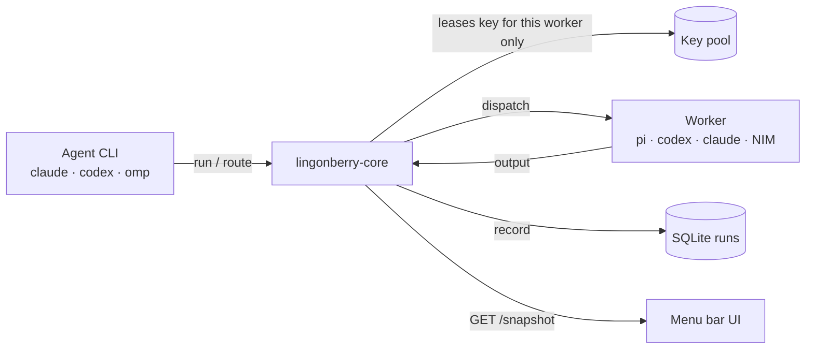

# Lingonberry Router

**One local router for every AI agent on your Mac.** Agents ask it for work; it picks a worker, leases a provider key for that worker only, runs the task, records it, and shows what is running in the menu bar.

[](https://github.com/brusnyak/lingonberry-router/actions/workflows/ci.yml)


[Install](#install) · [How it works](#how-it-works) · [CLI](#cli) · [HTTP API](#http-api) · [Config](#self-configuration) · [Known gaps](#known-gaps)

---

## Why

| Without it | With it |
|---|---|
| Each agent holds its own API keys | Keys stay in your env files; the router leases them |
| One runaway agent can burn a shared quota | Per-key concurrency and calls-per-minute limits |
| No record of who asked for what | Every run stores caller, worker, key slot, output and timing |
| You find out a worker is busy by waiting | The menu bar shows live work and lets you stop it |

## Install

Requires Rust (`cargo`) and, for the menu bar app, Xcode command-line tools.

```sh
git clone https://github.com/brusnyak/lingonberry-router.git
cd lingonberry-router/core
cargo install --path .                 # puts lingonberry-core on PATH
lingonberry-core doctor                 # read-only health check, exit 1 on any failure
```

Menu bar app (optional):

```sh
cd ui && swift build -c release
```

Provider keys go in `~/.env` or `~/.config/lingonberry/env` as `NAME=value`. The router reads the values itself; it never prints them.

## How it works



1. **Discover.** `lingonberry-core discover` scans PATH for agent CLIs and env files for key *names*. Each (agent, key slot) pair becomes a worker.
2. **Choose.** `route` prints a receipt (selected worker, alternatives, exclusions) without running anything.
3. **Lease.** A key is leased for the worker's provider only. A NIM request never receives a GROQ key. Each key allows 3 concurrent runs and 40 calls per minute; a dispatch waits up to 30 s, then fails.
4. **Run.** CLI agents run non-interactively with stdin closed (`claude -p`, `codex exec`, `opencode run`, `omp -p`, …; see [`core/src/agents.rs`](core/src/agents.rs)). Key-based workers call the provider's chat-completions endpoint.
5. **Record and show.** Runs are stored with the caller found by walking parent processes. The UI polls `GET /snapshot` every 2 s.

## Quick check

```sh
lingonberry-core route "summarise this README in one line"   # receipt only, nothing runs
lingonberry-core run --worker pi "say hi"                     # one real run
```

## CLI

| Command | Use |
|---|---|
| `init [--force]` | create `~/.lingonberry` and `config.json` (idempotent) |
| `doctor` | read-only health check, JSON |
| `discover` | agents, key names, workers |
| `route "<prompt>"` | choose a worker and print the receipt; does not run |
| `run "<prompt>" [--worker <id>] [--caller <name>] [--gate <cmd>] [--worktree] [--approve]` | dispatch one task |
| `fanout "<p1>" "<p2>" …` | one run per prompt, round-robin over workers |
| `serve [127.0.0.1:8799]` | HTTP API and run store |

`ROUTER_CALLER` overrides caller detection.

<a id="http-api"></a>

<details>
<summary><b>HTTP API (loopback)</b></summary>

| Method | Path | Use |
|---|---|---|
| GET | `/snapshot` | everything the UI shows: running workers, sessions, key slots, overview |
| GET | `/keys` | key-slot status |
| GET | `/runs`, `/runs/{id}` | run history and one run |
| GET | `/receipts`, `/receipts/{id}` | routing receipts |
| GET | `/discover` | discovered agents, key names, providers, workers |
| POST | `/kill/{pid}` | SIGTERM the process group of one live router worker; refused for any pid the router did not start |
| GET | `/version` | `exe_mtime` of the running binary |
| POST | `/shutdown` | stop this core |

</details>

<details>
<summary><b>Repo layout</b></summary>

```
core/src/main.rs        CLI, caller detection, run/route/fanout/serve
core/src/discovery.rs   agents, key names, env files, key values, workers
core/src/registry.rs    worker lookup, key leasing (provider-scoped, MAX_INFLIGHT)
core/src/agents.rs      non-interactive argv per agent CLI
core/src/server.rs      HTTP API, snapshot, kill, version, shutdown
core/src/storage.rs     SQLite run and receipt stores
core/src/types.rs       shared types (Run, Worker, LiveWorker, Snapshot …)
ui/Sources/LingonberryUI/main.swift   the menu bar app
HANDOFF.md              current state and open decisions
```

</details>

<a id="self-configuration"></a>

## Self-configuration

Nothing has to be set by hand.

- **First start.** `serve`, `run`, `route` and `fanout` write `~/.lingonberry/config.json` with defaults if it is missing.
- **Validation.** An invalid config stops the router with the exact problems. It never runs on a config it cannot trust.
- **Doctor.** `doctor` checks the state directory, config, database, discovered agents, key *names*, the default worker, excluded agents and the port.

| Key | Default | Meaning |
|---|---|---|
| `port` | 8799 | port for `serve` when no address is given |
| `default_worker` | `pi` | worker used when a run names none (must be routable) |
| `max_inflight_per_key` | 3 | concurrent runs per key slot |
| `rpm_per_key` | 40 | calls per key slot per 60 s |
| `cooldown_s` | 60 | rest after a failed call on a key slot |
| `lease_wait_s` | 30 | seconds a dispatch waits for a free key |
| `excluded_agents` | `["cline"]` | discovered but never routed to |

State lives in `~/.lingonberry` (override with `$LINGONBERRY_HOME`). Every decision that matters is one JSON line in `~/.lingonberry/logs/events.jsonl`; key values are never written there.

## Build and test

```sh
cd core && cargo test          # 13 unit tests
cd core && cargo build
cd ui && swift build           # debug
```

CI (`.github/workflows/ci.yml`) runs the core tests and build on Linux and a gitleaks secret scan on every push and pull request.

<a id="known-gaps"></a>

## Known gaps

- A worker whose output is truncated is marked `blocked`; it is not retried on another key yet.
- The planner does not skip workers that `doctor` marks down.
- `Lease` returns a bare key name with no RAII guard, so a panic between lease and release leaks an inflight slot.
- `fanout` runs are not written to the event log yet (only `run` is).
- Codex needs a model in `~/.codex/config.toml` that the ChatGPT login supports.

Current state and open decisions: [`HANDOFF.md`](HANDOFF.md).
